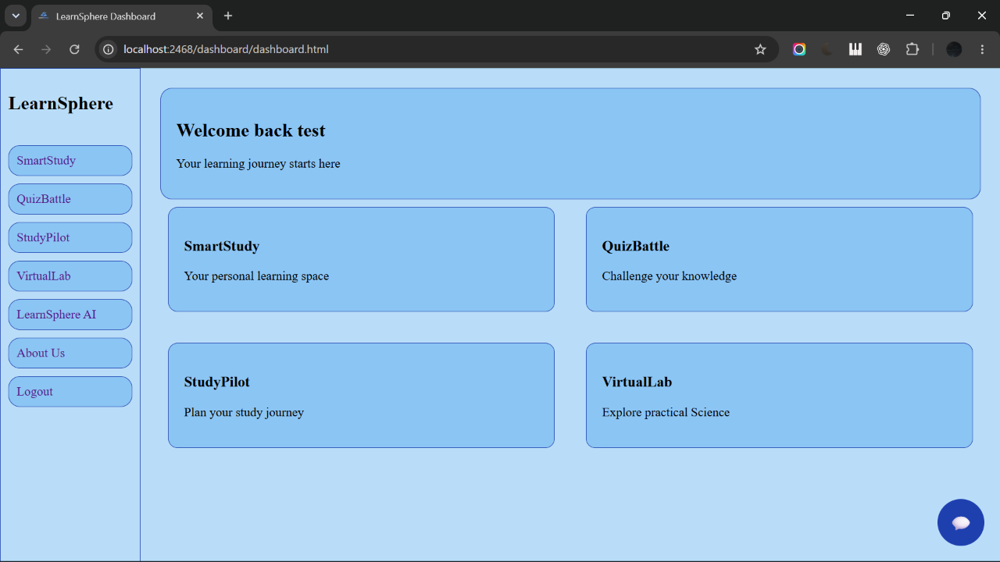
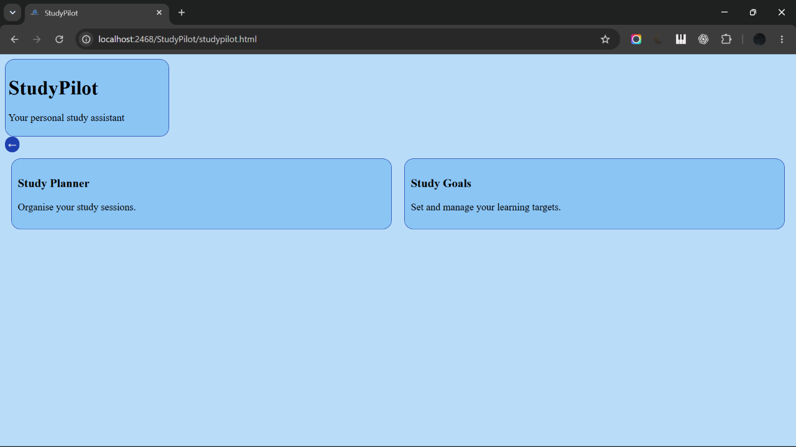

# LearnSphere v1.0.0

**Learn. Explore. Achieve.**

LearnSphere is an educational web application designed to make learning more interactive, accessible and engaging for students.

It combines study tools, quizzes and interactive learning experiences into one platform.

## About the Developer

- **Name:** Desmond Nana Yaw Appiah
- **Class:** Science 16
- **Project Type:** Solo Project
- **Project Name:** LearnSphere

## Features

### 1. SmartStudy
A learning section where students can explore academic subjects and topics.

### 2. QuizBattle
An interactive quiz platform that allows students to test their knowledge across different subjects.

### 3. StudyPilot
A study management section designed to help students organise their learning and set goals.

### 4. VirtualLab
An interactive science simulation section. The initial version focuses on projectile motion.

### 5. User Authentication
Login and registration functionality to provide students with access to their accounts.

### 6. About LearnSphere
Information about the project, its purpose and its developer.

## Technologies Used

- HTML – Page structure
- CSS – Styling and responsive layouts
- JavaScript – Interactivity and functionality
- Node.js – Server-side runtime
- Express.js – Web application framework
- JSON – Data storage for selected application features

## Running the Project

1. Install Node.js.
2. Install the following packages/dependencies - 

i. **Express** - ```  npm install express ```
ii. **bcrypt** - ``` npm install bcrypt ```
iii. **Express-session** - ``` npm install express-session ```
iv. **Groq-sdk** - ``` npm install groq-sdk dotenv ```

3. Create a .env file and place
3. Get a Groq API key from [Groq console](https://console.groq.com/keys).
4. Place the key in the .env file under the environment variable "GROQ_API_KEY".
5. Get a random string using ``` node -e "console.log(require('crypto').randomBytes(32).toString('hex'))" ``` and place it in "SESSION_SECRET" .env file.

6. Open the LearnSphere project folder in your terminal.
7. Start the server:

   ``` node server.js ```

8. Open your browser and visit:

   `http://localhost:2468`

## Development Checklist

- [x] Login and registration
- [x] Dashboard
- [x] SmartStudy
- [x] QuizBattle
- [x] Quiz questions and scoring
- [x] StudyPilot HTML and CSS
- [x] Complete StudyPilot functionality
- [x] Build VirtualLab projectile-motion simulation
- [x] Complete AI chatbot functionality
- [x] Connect and test all pages
- [x] Fix remaining bugs
- [x] Complete documentation
- [x] Prepare project presentation

## Project Goal

LearnSphere aims to demonstrate how technology can be used to improve the learning experience and make education more engaging for students.

## Note 

The AI uses a Groq API key, so if you do not have one, follow this link: [Groq Console](https://console.groq.com/keys) 

---

**Developed independently by Desmond Nana Yaw Appiah.**

*Learn. Explore. Achieve.*

## Screenshots

### Dashboard


### SmartStudy


### QuizBattle


### StudyPilot


### VirtualLab


### LearnSphere AI

